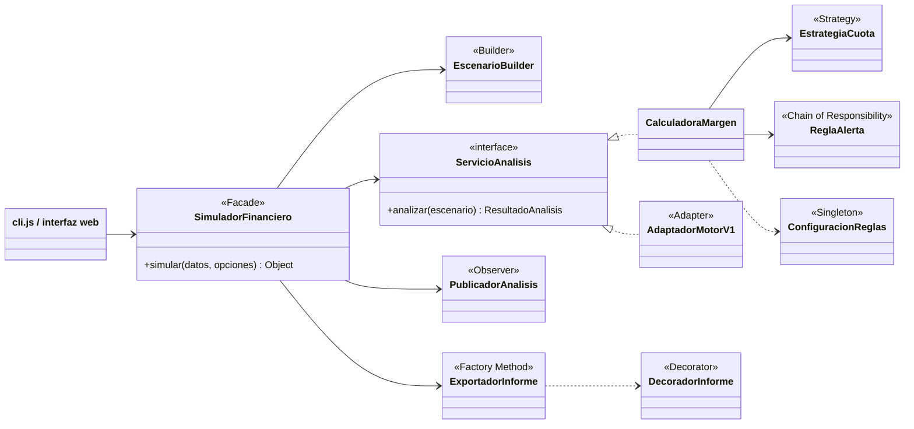
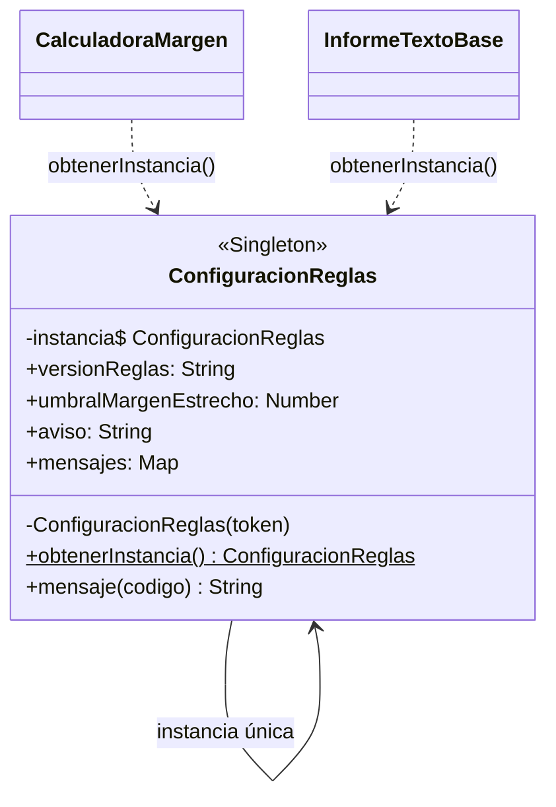
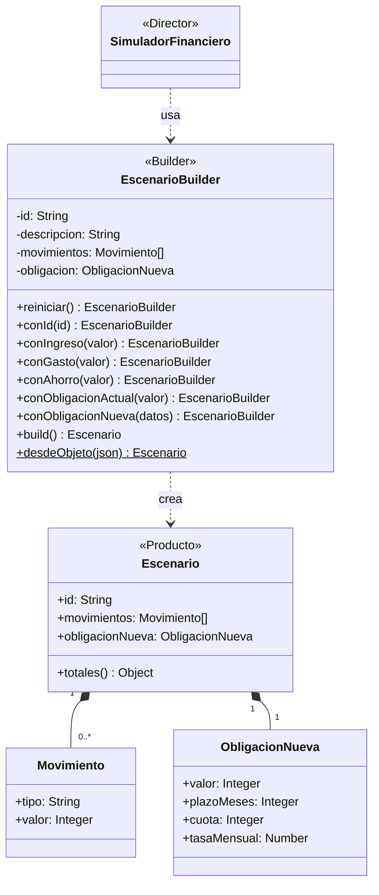
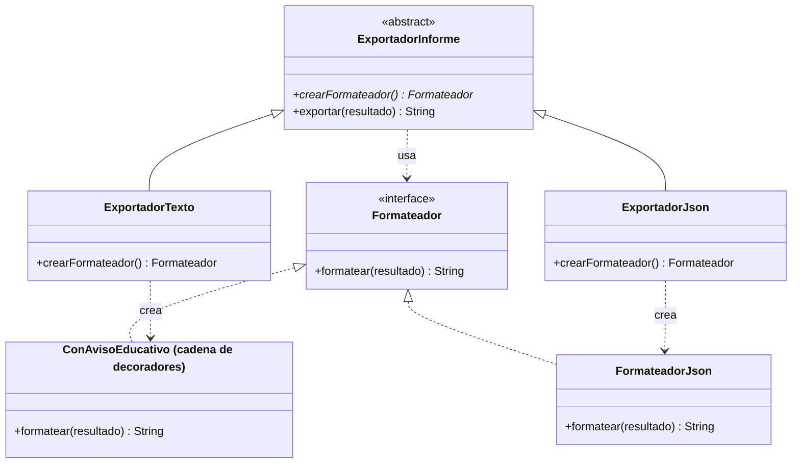
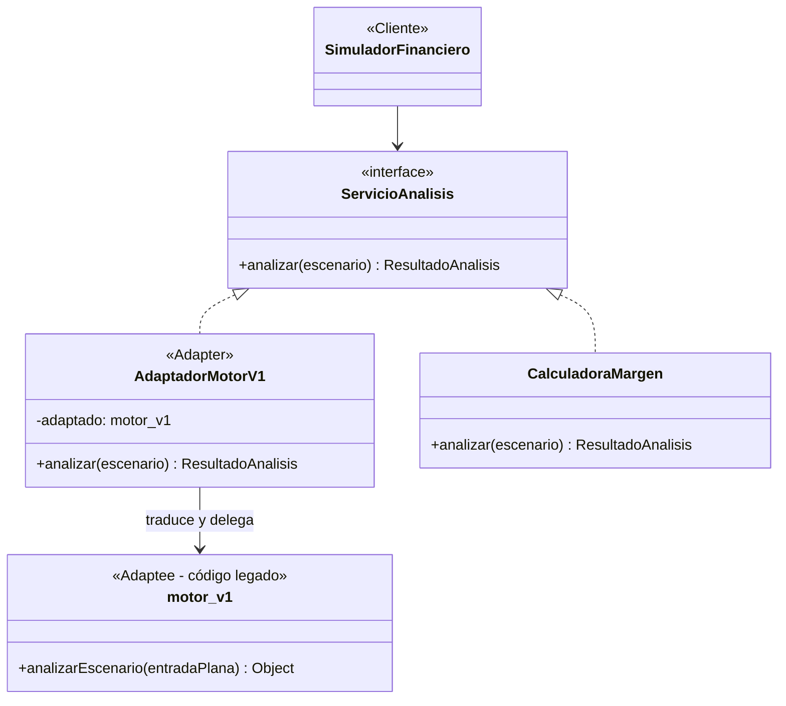
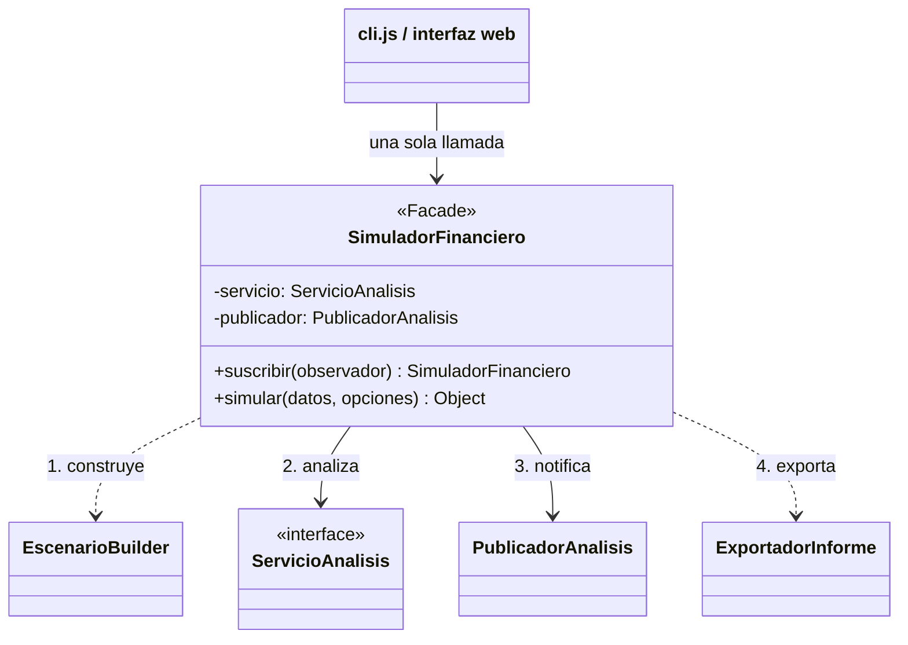
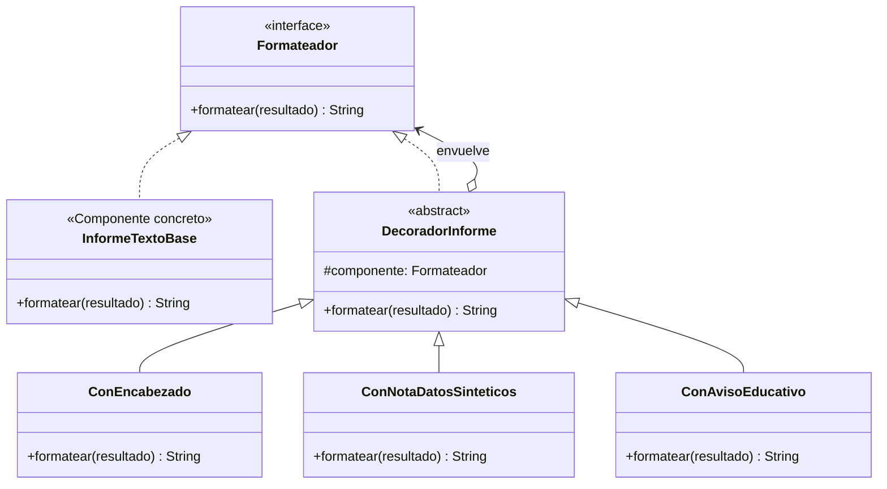
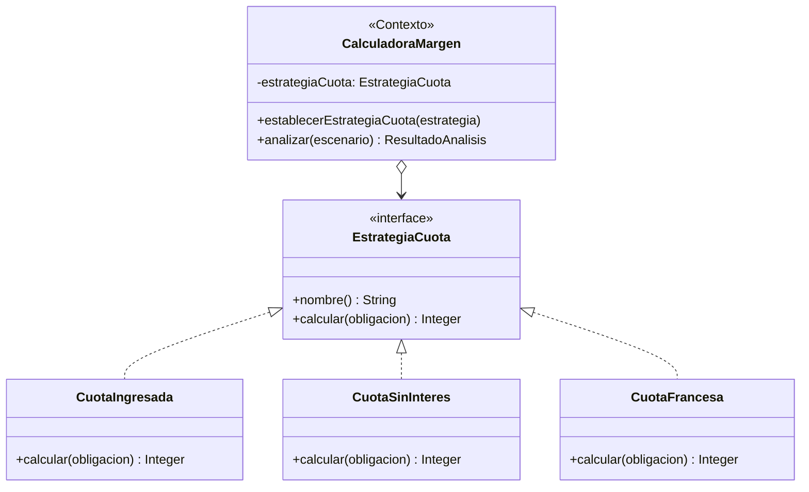
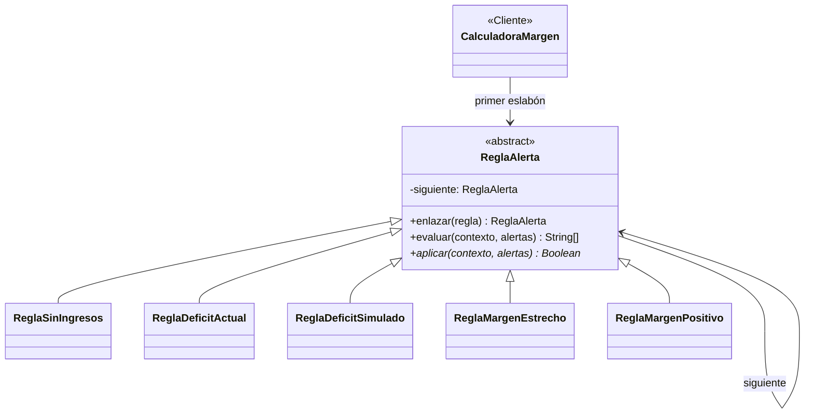
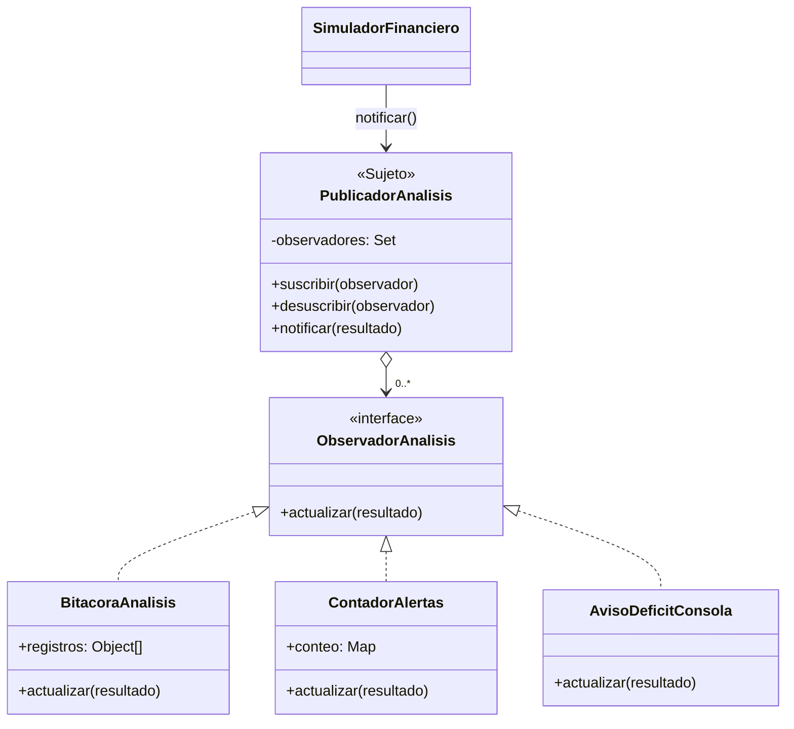

# FinUCompensar · Patrones de diseño

Refactorización del motor de simulación financiera de **FinUCompensar** aplicando patrones de diseño creacionales, estructurales y comportamentales.

**Fundación Universitaria Compensar · Ingeniería de Software · Patrones de Diseño · 2026-2**

Integrantes:
- Johan David Vásquez Doncel
- Alejandro Forero Saavedra
- Rolando Stiven Ramírez Rozo

## Qué es FinUCompensar

Prototipo web educativo para que estudiantes de UCompensar en práctica empresarial vean, antes de aceptar una nueva cuota, cómo cambiaría su margen mensual. El sistema no aprueba créditos, no consulta centrales de riesgo y trabaja solo con datos sintéticos.

Este repositorio toma el motor de cálculo v1.0.0 de la prueba de concepto ([FinUCompensar-evidencias](https://github.com/vasquezdonceljohandavid-ctrl/FinUCompensar-evidencias)) y lo reorganiza con 9 patrones de diseño, sin cambiar sus resultados: la prueba de regresión compara el motor nuevo con el anterior en los 10 escenarios semilla y exige desviación de 0 pesos.

## Cómo ejecutarlo

Requiere Node.js 20 o superior. No usa dependencias externas.

```bash
npm test                 # 40 pruebas automáticas (regresión + una suite por patrón)
npm run demo             # informe del escenario S01 en texto
node src/cli.js S06 json # otro escenario, en JSON
```

## Patrones implementados

| Tipo | Patrón | Archivo | Para qué se usa |
|---|---|---|---|
| Creacional | Singleton | `src/creacionales/ConfiguracionReglas.js` | Una sola fuente para la versión de reglas, el umbral del 10 %, los mensajes y el aviso educativo. |
| Creacional | Builder | `src/creacionales/EscenarioBuilder.js` | Arma paso a paso un escenario con varios movimientos y la obligación nueva, y lo valida al final. |
| Creacional | Factory Method | `src/creacionales/ExportadorInforme.js` | Cada exportador (texto, JSON) decide qué formateador crear; un formato nuevo es una subclase nueva. |
| Estructural | Adapter | `src/estructurales/AdaptadorMotorV1.js` | Reutiliza el motor v1.0.0 legado detrás de la interfaz nueva `analizar(Escenario)`. |
| Estructural | Facade | `src/estructurales/SimuladorFinanciero.js` | Una sola operación `simular()` oculta construcción, cálculo, alertas, notificación y exportación. |
| Estructural | Decorator | `src/estructurales/DecoradoresInforme.js` | Agrega encabezado, nota de datos sintéticos y aviso educativo al informe sin subclases por combinación. |
| Comportamental | Strategy | `src/comportamentales/EstrategiasCuota.js` | Cuota ingresada, sin interés o sistema francés, intercambiables en tiempo de ejecución. |
| Comportamental | Chain of Responsibility | `src/comportamentales/ReglasAlerta.js` | Las 5 alertas educativas se evalúan como eslabones; las excluyentes cortan la cadena. |
| Comportamental | Observer | `src/comportamentales/Observadores.js` | Bitácora, contador de alertas y aviso en consola se enteran de cada análisis sin acoplarse. |

## Arquitectura general



## Diagramas de clases por patrón

### Singleton (creacional)

Una sola fuente para la versión de reglas, el umbral del 10 %, los mensajes y el aviso educativo.

Código: `src/creacionales/ConfiguracionReglas.js` · Diagrama: [`docs/uml/01_singleton.svg`](docs/uml/01_singleton.svg)



### Builder (creacional)

Arma paso a paso un escenario con varios movimientos y la obligación nueva, y lo valida al final.

Código: `src/creacionales/EscenarioBuilder.js` · Diagrama: [`docs/uml/02_builder.svg`](docs/uml/02_builder.svg)



### Factory Method (creacional)

Cada exportador (texto, JSON) decide qué formateador crear; un formato nuevo es una subclase nueva.

Código: `src/creacionales/ExportadorInforme.js` · Diagrama: [`docs/uml/03_factory_method.svg`](docs/uml/03_factory_method.svg)



### Adapter (estructural)

Reutiliza el motor v1.0.0 legado detrás de la interfaz nueva `analizar(Escenario)`.

Código: `src/estructurales/AdaptadorMotorV1.js` · Diagrama: [`docs/uml/04_adapter.svg`](docs/uml/04_adapter.svg)



### Facade (estructural)

Una sola operación `simular()` oculta construcción, cálculo, alertas, notificación y exportación.

Código: `src/estructurales/SimuladorFinanciero.js` · Diagrama: [`docs/uml/05_facade.svg`](docs/uml/05_facade.svg)



### Decorator (estructural)

Agrega encabezado, nota de datos sintéticos y aviso educativo al informe sin subclases por combinación.

Código: `src/estructurales/DecoradoresInforme.js` · Diagrama: [`docs/uml/06_decorator.svg`](docs/uml/06_decorator.svg)



### Strategy (comportamental)

Cuota ingresada, sin interés o sistema francés, intercambiables en tiempo de ejecución.

Código: `src/comportamentales/EstrategiasCuota.js` · Diagrama: [`docs/uml/07_strategy.svg`](docs/uml/07_strategy.svg)



### Chain of Responsibility (comportamental)

Las 5 alertas educativas se evalúan como eslabones; las excluyentes cortan la cadena.

Código: `src/comportamentales/ReglasAlerta.js` · Diagrama: [`docs/uml/08_chain.svg`](docs/uml/08_chain.svg)



### Observer (comportamental)

Bitácora, contador de alertas y aviso en consola se enteran de cada análisis sin acoplarse.

Código: `src/comportamentales/Observadores.js` · Diagrama: [`docs/uml/09_observer.svg`](docs/uml/09_observer.svg)



## Estructura

```
src/
  dominio/           Movimiento, ObligacionNueva, Escenario, ResultadoAnalisis, ErrorValidacion
  creacionales/      Singleton, Builder, Factory Method
  estructurales/     Adapter, Facade, Decorator
  comportamentales/  Strategy, Chain of Responsibility, Observer, CalculadoraMargen
  legado/motor_v1.js motor v1.0.0 original (sin cambios)
  cli.js             demostración por consola
test/                regresión y pruebas por patrón (node:test)
datos/               10 escenarios semilla sintéticos
docs/uml/            diagramas de clases (Mermaid .mmd y .svg)
```

Datos 100 % sintéticos. El repositorio no contiene datos personales ni credenciales.
